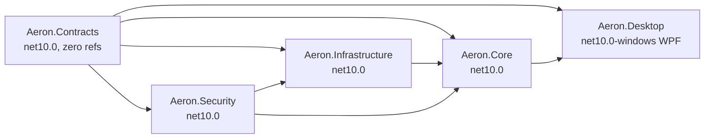
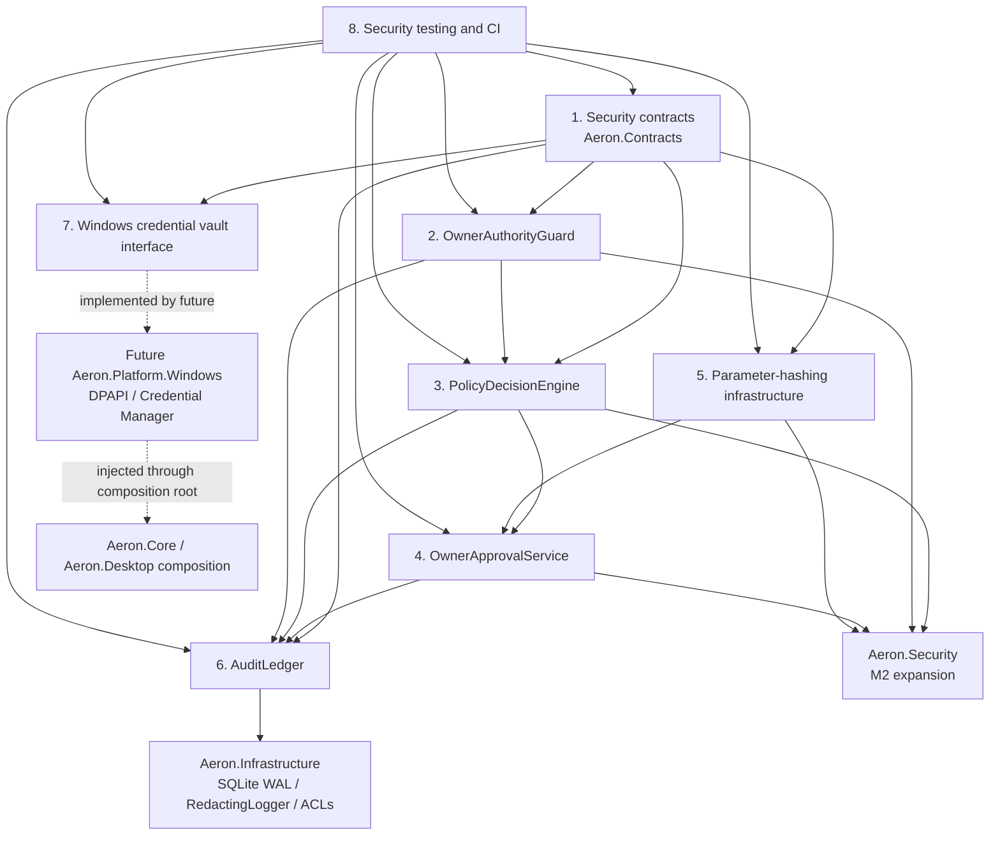

# M2 Dependency Graph

> Status: `PROPOSED / NOT IMPLEMENTATION`.  
> Preserves the existing project dependency structure. No project reference or package was changed.

## 1. Actual existing project references

Verified from current `.csproj` files and `Aeron.Architecture.Tests`: `Aeron.Contracts` has no project/package references; `Aeron.Security` references `Contracts` only; `Aeron.Infrastructure` references `Contracts` + `Security`; `Aeron.Core` references `Contracts` + `Infrastructure` + `Security`; `Aeron.Desktop` references `Contracts` + `Core`.

## 2. Proposed M2 component graph

## 3. Proposed future Windows vault module boundary

- `IWindowsCredentialVault` is proposed in `Aeron.Contracts`.
- A future `Aeron.Platform.Windows` module would implement that interface using built-in Windows DPAPI/Credential Manager and depend on `Aeron.Contracts`, not on `Aeron.Security`.
- `Aeron.Security` consumes the interface from `Aeron.Contracts`; `Aeron.Core`/`Aeron.Desktop` composition injects the implementation.
- This avoids a `Aeron.Security` ↔ `Aeron.Platform.Windows` cycle and preserves the acyclic graph.
- No direct project reference, package, or module is created in this specification task.
- No third-party vault dependency is proposed; any future third-party dependency would require explicit justification and Owner approval.

## 4. Dependency table

| # | Node | Depends on | Responsibility | Failure state |
|---:|---|---|---|---|
| 1 | Security contracts | `Aeron.Contracts` only | Typed action, classification, policy, approval, hash, audit, vault interfaces | Missing/invalid contract denies |
| 2 | OwnerAuthorityGuard | Security contracts, policy version, Owner state | Owner preemption, precedence, inheritance, fail-closed authority | `OwnerPreempted`, `AuthorityStateUnknown`, `PolicyVersionMismatch` |
| 3 | PolicyDecisionEngine | Security contracts, classifiers, destination validator, policy version | Deterministic default-deny `G1`–`G4` / `L0`–`L3` evaluation and evidence | `UnclassifiedAction`, `AmbiguousRequest`, `CanonicalSpecUnresolved` |
| 4 | OwnerApprovalService | Parameter hasher, PolicyDecisionEngine, OwnerAuthorityGuard | Explicit expiring single-use approvals and immediate revalidation | `Expired`, `Cancelled`, `Denied`, `ParameterMismatch`, `Preempted` |
| 5 | Parameter-hashing infrastructure | Security contracts, redaction | Protected exact-operation binding, separate redacted display and audit | `CanonicalizationFailed`, `RedactionFailed`, `HashMismatch` |
| 6 | AuditLedger | Security contracts, `Aeron.Infrastructure` SQLite WAL/redaction/ACLs | Append-only hash-chained redacted audit records and startup verification | `ChainMismatch`, `WriteFailed`, `WALCorrupt`, `StorageUnavailable` |
| 7 | Windows credential vault | `IWindowsCredentialVault`, Windows DPAPI/Credential Manager, ACLs, config validator | Secret lifecycle, zero secrets in `aeron.config.json`, backup constraints | `VaultUnavailable`, `DecryptFailed`, `InlineSecretRejected`, `BackupUnsafe` |
| 8 | Security testing and CI | All components, Windows runner, architecture/hygiene tests | Automated proof of default deny, approval, audit, vault, redaction, crash recovery, graph preservation | CI failure denies acceptance |

## 5. Status

`PROPOSED / NOT IMPLEMENTATION`. M2 BUILD remains blocked until Owner review and explicit authorization.

## v1.1 security dependency matrix (`PROPOSED`)

| Capability | Depends on | Evidence / constraint |
|---|---|---|
| Owner authority and revocation | Security contracts, Owner state, policy version | U-8R.2/.13/.15; ADR-AUTH-001/003; defined irreversible execution boundary |
| Policy and device authorization | Guard, classifications, device trust, revoked grants | U-8R.1/.8/.9, G1–G4/L0–L3; default deny |
| Approval and amendments | Policy, Owner state, secure exact-operation binding | ADR-AUTH-002; Owner approval before amendment effect; consequential approval |
| Audit and notifications | Redaction, audit store, independently protected checkpoint | U-8R.7/.14; whole-chain replacement/truncation detection |
| MFA and vault | Authentication design, device trust, DPAPI/Credential Manager abstraction | U-8R.3/.4/.9; vault does not supply MFA by itself |
| Backup and recovery | Reviewed scope, encryption and key custody, G2/G4 policy, Owner controls | U-8R.4/.10/.11; Google Drive recorded; unresolved secrets/restore |
| Tests and CI | All above, Windows-specific test runner | Design review first; tests/builds not run in spec revision |

Arrows in section 1 denote the provider-to-consumer direction; no existing project references are changed. Source verification and Owner specification lock precede any BUILD authorization.
