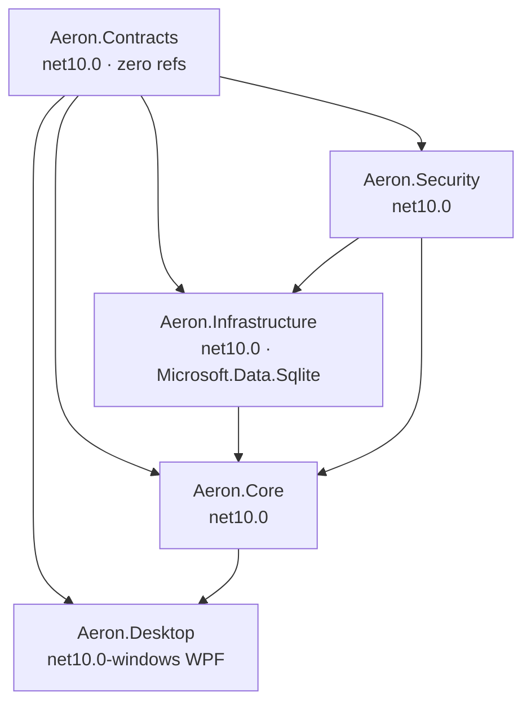
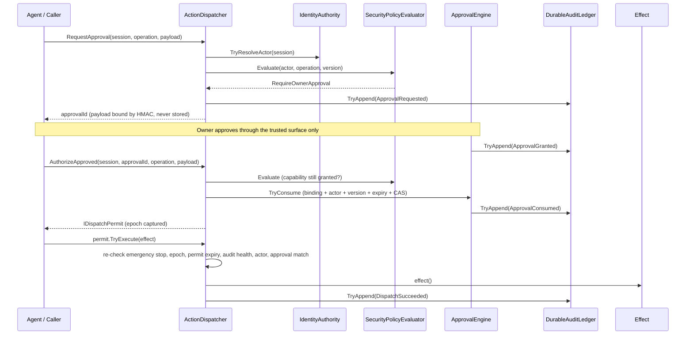

# AERON M2 — Implemented Security Architecture (as built)

> Copyright (c) 2026 Avenox Studio. All Rights Reserved.
>
> Status: `IMPLEMENTED — PENDING OWNER ACCEPTANCE`.
>
> This document describes the code that exists in `src/` today. It is deliberately
> separate from `SECURITY-ARCHITECTURE.md`, which remains the **proposed** specification.
> Where the implementation is narrower than the proposal, this document says so. Nothing
> here claims M2 acceptance, runtime verification, or Owner approval.

## 1. Component inventory

| Component | Assembly | File | Status |
|---|---|---|---|
| Identity authority | `Aeron.Security` | `IdentityAuthority.cs` | `COMPLETE` — fail-closed without an approved factor policy |
| Owner factor policy contract | `Aeron.Contracts` | `IdentityContracts.cs` | `COMPLETE` (contract) |
| Unapproved factor policy | `Aeron.Security` | `IdentityStores.cs` | `COMPLETE` (deliberate denial) |
| Agent registry | `Aeron.Security` | `AgentRegistry.cs` | `PARTIAL` — volatile, Owner-provisioned |
| Agent signature verifier | `Aeron.Security` | `IdentityStores.cs` | `COMPLETE` — ECDSA P-256 |
| Nonce store (replay) | `Aeron.Security` | `IdentityStores.cs` | `COMPLETE` — volatile, bounded |
| Permission store | `Aeron.Security` | `IdentityStores.cs` | `PARTIAL` — volatile; Owner re-grants on start |
| Policy evaluator | `Aeron.Security` | `SecurityPolicyEvaluator.cs` | `COMPLETE` — deterministic default-deny |
| Approval engine | `Aeron.Security` | `ApprovalEngine.cs` | `COMPLETE` |
| Durable approval store | `Aeron.Security` | `DurableApprovalStore.cs` | `COMPLETE` — single-writer, atomic writes |
| Approver trust registry | `Aeron.Security` | `DurableApprovalStore.cs` | `PARTIAL` — in-process only (D2-08) |
| Operation binding | `Aeron.Security` | `OperationBinding.cs` | `COMPLETE` — HMAC-SHA-256, V3 framing |
| Durable audit ledger | `Aeron.Security` | `DurableAuditLedger.cs` | `COMPLETE` — chain + checkpoint verification |
| File checkpoint anchor | `Aeron.Security` | `SecurityKernel.cs` | `PARTIAL` — same-user, weak (D2-07) |
| Action dispatcher | `Aeron.Security` | `ActionDispatcher.cs` | `COMPLETE` — audit-before-effect, epoch guard |
| Preemption / emergency stop | `Aeron.Security` | `PreemptionState.cs` | `COMPLETE` — latch + epoch |
| Permission administration | `Aeron.Security` | `PreemptionState.cs` | `COMPLETE` — Owner-only |
| Windows credential vault | `Aeron.Security` | `WindowsCredentialVault.cs` | `BLOCKED` on D2-05/D2-06 (implementation complete, storage refused) |
| DPAPI protector | `Aeron.Infrastructure` | `DpapiDataProtector.cs` | `COMPLETE` — built-in `crypt32.dll` |
| Windows account source | `Aeron.Infrastructure` | `WindowsAccountIdentitySource.cs` | `COMPLETE` — OS token |
| Kernel composition | `Aeron.Security` | `SecurityKernel.cs` | `COMPLETE` |
| Production composition | `Aeron.Core` | `SecurityComposition.cs` | `COMPLETE` |
| Foundation wiring | `Aeron.Core` | `FoundationHost.cs` | `COMPLETE` |
| Desktop security surface | `Aeron.Desktop` | `SecurityViewModel.cs`, `MainWindow.xaml` | `PARTIAL` — read-only while D2-01 is open |

## 2. Dependency graph (verified by `Aeron.Architecture.Tests`)

`Aeron.Security` contains **no** Windows interop and **no** packages. Windows primitives
(DPAPI, token SID, ACLs) live in `Aeron.Infrastructure` and are injected. This preserves
the acyclic graph and keeps the kernel logic testable on any host.

## 3. Authority flow at the action boundary

Three independent conditions must hold at `TryExecute`: no preemption since authorization,
a healthy audit ledger, and a still-live actor session with an approval that matches the
exact operation. No single check is sufficient.

## 4. What is enforced, precisely

### 4.1 Default deny

- `SecurityPolicyEvaluator` maps every `SecurityAction` to exactly one
  (capability, tier, domain) triple; anything unmapped yields `L3`/Deny.
- `SecurityAction.Unknown`, `DataSensitivity.Unknown`, an invalid policy version, a
  secret-bearing operation, a missing actor, and a missing permission store each have a
  distinct denial reason and a distinct rule code that is tested.
- There is **no** dispatch path for `RemoteInference`, `DiscloseData`,
  `SendCommunication`, `ModifyExternalAccount`, `ChangeAuthority`, `ExecuteSkillScript`, or
  `ModifyLocalData`. These deny with `rule.no_m2_dispatch_path` because the modules that
  would perform them do not exist in M2.

### 4.2 No self-elevation

- `PermissionAdministration.Grant` requires Owner evidence that resolves to a **live Owner
  session minted by the identity authority**; an agent session id fails.
- Owner-kind grants are rejected outright: Owner authority is intrinsic, never a grant.
- An agent can request approval (`ReadLocalData`, `ViewSecurityStatus`, …) only for
  capabilities the Owner granted it.

### 4.3 Agent isolation

- Each agent has its own ECDSA P-256 key; the registry stores the SubjectPublicKeyInfo.
- Agent authentication consumes the nonce **before** signature verification, so a nonce
  is single-use even for a forgery attempt.
- A revoked agent's live sessions are revoked immediately and re-registration is refused
  for the rest of the process.
- Sessions resolve to exactly one actor; one agent cannot act as another.

### 4.4 Approval integrity

- Binding: HMAC-SHA-256 over domain separator, approval id, action, actor subject,
  actor kind, target, policy version, and raw payload — all length-framed.
- Consumption re-verifies: session actor == approval actor (subject **and** kind), action,
  sensitivity, target, policy version, expiry, current capability, and binding.
- Exactly one caller wins the Approved→Consumed compare-and-set (16-way concurrency test).
- Payload bytes are never persisted: the approval store holds only the 32-byte binding.

### 4.5 Audit durability

- Fixed 160-byte records, big-endian, SHA-256 chained.
- Detail codes are filtered to `[a-z0-9._-]`, padded to 16 bytes; free text and secrets
  cannot be represented.
- Every authorizing operation appends **before** the effect (`DispatchAuthorized`) and
  a failure to append is a denial.
- Verification detects: interior modification, reordering, interior deletion, truncation
  against the checkpoint, whole-file replacement, and a one-record unanchored tail.
- The unanchored tail is **never** auto-trusted: the ledger latches and only
  `AttemptRecovery()` — an explicit Owner-visible call — re-anchors a single verified
  record. Everything else stays failed.

### 4.6 Honest limitations

- The checkpoint is a same-user file. Rollback resistance is **not** claimed; the status
  surface says so (D2-07).
- Emergency stop cannot reverse an external side effect already started.
- Approver separation is in-process (D2-08).
- Agents run as the Owner's Windows user (D2-04).
- Vault storage is blocked (D2-05/D2-06).
- Owner MFA is unimplemented by design (D2-01); no Owner session exists in production, so
  every Owner-only control is unavailable.

## 5. Desktop surface behavior

| Surface | Data source | Behavior when unresolved |
|---|---|---|
| Owner status | `IdentityAuthority` | States the factor policy is unresolved; unlock command disabled |
| Audit integrity | `DurableAuditLedger.VerifyIntegrity` | Shows `Tampered`/`Unhealthy` and the diagnostic |
| Approval engine | `ApprovalEngine.ListOutstanding` | Shows outstanding count |
| Sessions / agents | `IdentityAuthority` counters | Shows real counts |
| Vault | `UnapprovedVaultEncryptionPolicy` | "Blocked (policy unresolved)" |
| Emergency stop | `PreemptionState` | Explains a live Owner session is required |
| Audit trail | `ReadAuditTrail(40)` | Sequence, kind, machine detail code, 8-char correlation prefix |

No control is decorative: each command calls a kernel service and reports the real result,
including refusals.

## 6. Test coverage map

| Requirement | Test file |
|---|---|
| Authentication failures | `M2/IdentityAuthorityTests.cs` |
| Permission escalation | `M2/AuthorizationTests.cs` |
| Agent isolation | `M2/AuthorizationTests.cs` |
| Owner preemption | `M2/IdentityAuthorityTests.cs`, `M2/ApprovalEngineTests.cs` |
| Approval replay | `M2/ApprovalEngineTests.cs` |
| Parameter tampering | `M2/ApprovalEngineTests.cs` |
| Concurrent approval/revocation | `M2/ApprovalEngineTests.cs` |
| Audit tampering / truncation / replacement | `M2/DurableAuditLedgerTests.cs` |
| Checkpoint failures / crash recovery | `M2/DurableAuditLedgerTests.cs` |
| Vault failures | `M2/VaultTests.cs` |
| Secret leakage | `M2/VaultTests.cs`, `M2/DurableAuditLedgerTests.cs` |
| Invalid policy versions | `M2/PolicyVersionAndSessionTests.cs`, `M2/AuthorizationTests.cs` |
| Unauthorized action attempts | `M2/AuthorizationTests.cs` |
| Composition wiring | `Aeron.Core.Tests/SecurityKernelCompositionTests.cs` |
| Desktop surface honesty | `Aeron.Desktop.Tests/SecuritySurfaceTests.cs` |
| Architecture invariants | `Aeron.Architecture.Tests/ArchitectureTests.cs` |
